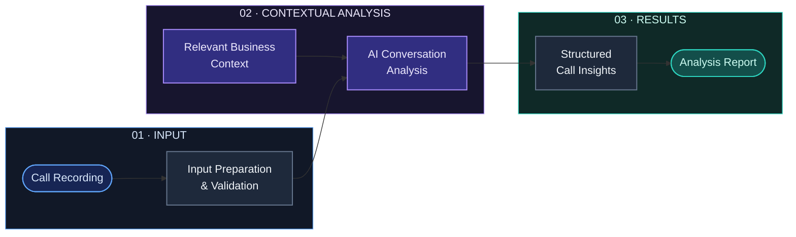
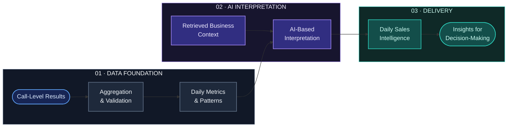
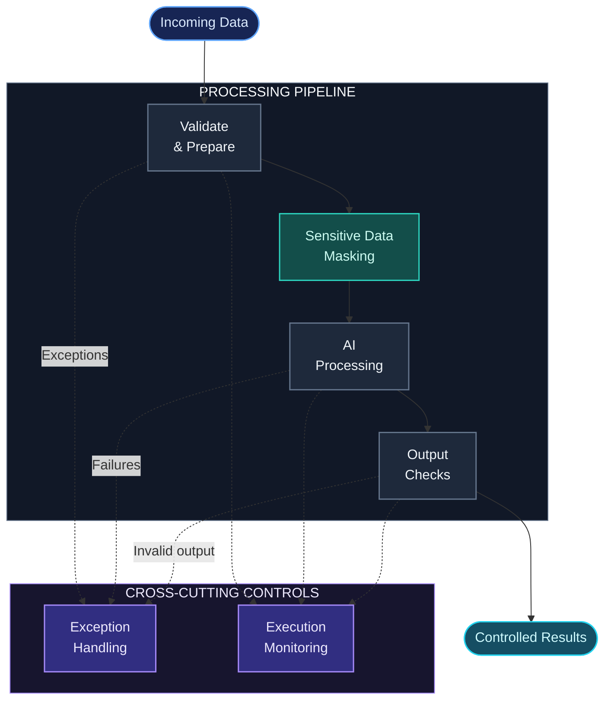

# Intelligent Sales Automation

  <strong>Turning Sales Conversations into Actionable Intelligence.</strong>
   
  AI Engineering · LLMs · RAG · Workflow Automation

  
  
  
  

---

## Overview

Sales conversations contain valuable signals: customer needs, objections, buying intent, sales performance, and opportunities for improvement. Much of that information is difficult to use consistently when conversations are reviewed manually.

**Intelligent Sales Automation** transforms sales calls into structured, context-aware intelligence using AI-powered analysis and automated workflows.

The system combines two complementary analytical paths with a shared Retrieval-Augmented Generation (RAG) layer:

- **System 2 — Per-Call Intelligence:** Analyzes individual conversations and extracts actionable insights.
- **System 1 — Daily Sales Intelligence:** Aggregates call-level information to identify broader patterns, trends, and opportunities.
- **Shared Knowledge Layer:** Supplies relevant business context to both analytical systems.

The objective goes beyond summarization: it is to turn individual conversations and collective sales activity into information that can support better decisions.

> **Engineering focus:** Context-aware analysis, resilience to low-quality audio, privacy-aware processing, and reliable workflow execution.

## At a Glance

| Area | Capability |
|---|---|
| Per-call analysis | Extracts structured insights from individual conversations |
| Daily intelligence | Identifies patterns across aggregated call data |
| Knowledge grounding | Uses shared RAG to provide relevant business context |
| Audio resilience | Successfully tested with noisy, low-quality audio at a 6 kHz sample rate |
| Data privacy | Uses masking layers to protect sensitive customer information |
| Automation | Orchestrates processing through automated workflows |

---

## Architecture

The diagrams below present the system at three levels: the overall architecture, the two analytical paths, and the cross-cutting concerns of privacy and reliability.

They are intentionally abstract. The purpose is to explain the engineering design without disclosing proprietary workflow logic, internal configuration, or sensitive integration details.

### 01. System Architecture

The two systems serve different analytical purposes but share a common knowledge foundation.

**Design principle:** Shared knowledge, distinct analytical responsibilities. System 2 focuses on individual calls; System 1 focuses on aggregated sales intelligence.

### 02. System 2 — Per-Call Intelligence

System 2 focuses on understanding a single sales conversation and producing structured insights that can support follow-up and sales decisions.

**Primary purpose:** Turn a single conversation into useful, context-aware sales intelligence.

### 03. System 1 — Daily Sales Intelligence

System 1 shifts the focus from individual conversations to collective performance. It combines aggregated call-level information with business context to produce a broader analytical view.

**Primary purpose:** Identify recurring objections, performance patterns, risks, and opportunities across multiple calls.

Quantitative aggregation and AI interpretation have distinct roles: validated data provides the numerical foundation, while AI helps explain patterns and generate higher-level insights.

### 04. Privacy & Reliability

Privacy and reliability are cross-cutting engineering concerns. The conceptual flow below highlights sensitive-data masking, output checks, exception handling, and execution monitoring without exposing implementation-specific controls.

The diagram communicates the intended design at a conceptual level. It does not imply that every control is implemented identically across all processing paths.

---

## Workflow Architecture

The following screenshots show the actual n8n workflows behind the two intelligence systems. They complement the conceptual diagrams above with a view of the workflow implementation.

### System 1 — Daily Sales Intelligence

*Workflow for daily sales intelligence and aggregated analysis.*

### System 2 — Per-Call Intelligence

*Workflow for processing and analyzing individual sales calls.*

---

## Demo — Real Sales Call Analysis

This demonstration connects a real audio sample with its corresponding AI-generated call intelligence report.

**Scenario:** Scenario 5 — Outbound Call — Good Salesperson  
**Call date:** October 7, 2026

| Resource | Description |
|---|---|
| [Read the Analysis Report (PDF)](https://github.com/SinaKakavand/Intelligent_Sales_Automation/blob/main/Demo/Call%20Intelligence%20-%20Scenario%205%20-%20Outbound%20Call%20-%20Good%20Salesperson%20-%202026-10-07.pdf) | Review the generated call intelligence report |
| [Listen to the Sample Call (WAV)](https://github.com/SinaKakavand/Intelligent_Sales_Automation/blob/main/Demo/Scenario%205%20-%20Outbound%20Call%20-%20Good%20Salesperson.wav) | Access the audio recording used in the demonstration |

### What This Demo Illustrates

- An example of an outbound sales conversation.
- The relationship between a call recording and its corresponding analysis report.
- How conversational data can be transformed into structured sales intelligence.

*This demonstration represents one scenario, not a comprehensive performance benchmark.*

---

## Engineering Highlights

### 1. Resilience to Low-Quality Audio

Real-world recordings are not always clean. Calls can contain background noise, limited bandwidth, weak microphones, or other recording artifacts.

During testing, the workflow successfully processed audio files with a **6 kHz sample rate**, including low-quality recordings with substantial noise.

This demonstrates that the workflow was tested beyond ideal recording conditions. It is a result from the tested scenarios, not a guarantee of equivalent performance for every recording, language, noise level, or transcription model.

### 2. Privacy-Aware Customer Data Handling

Sales conversations can contain personally identifiable and commercially sensitive information.

The system includes **masking layers for sensitive customer information** to reduce unnecessary exposure during processing.

The privacy approach includes:

- Identifying sensitive information that requires protection.
- Masking relevant customer details at appropriate processing stages.
- Avoiding the exposure of real customer information in public documentation and demonstrations.
- Keeping credentials, private integration details, and production payloads out of the public repository.

Masking is one layer of privacy protection. It does not replace access controls, secure credential management, data-retention policies, or appropriate handling of model inputs and outputs.

### 3. Shared RAG for Contextual Analysis

Both intelligence systems use a shared retrieval layer to bring relevant business knowledge into the analysis process.

This separates contextual retrieval from each system's analytical objective, allowing individual calls and daily aggregates to be interpreted against a consistent knowledge foundation.

### 4. Structured Analytics and AI Reasoning

The daily intelligence path distinguishes quantitative aggregation from AI-based interpretation.

Where possible, metrics should be calculated from validated source data, while the language model focuses on explaining patterns and generating higher-level insights. This separation helps reduce reliance on unconstrained model-generated numbers.

### 5. Workflow-Oriented Engineering

The system is organized around automated workflow execution, with attention to input preparation, contextual retrieval, structured outputs, exception handling, and downstream reporting.

The public repository documents the architecture and engineering considerations while keeping the complete proprietary workflow private.

---

## Repository Contents

The repository includes the README and supporting directories:

- [`Demo/`](./Demo) — demonstration materials.
- [`Screenshots_workflow/`](./Screenshots_workflow) — workflow screenshots.

All conceptual architecture diagrams are embedded directly in this README using Mermaid. No separate diagram files are required.

---

## Scope & Transparency

This repository is an **AI Engineering Case Study**, not a public release of the complete production workflow.

It communicates the system's architecture, analytical approach, and selected engineering considerations while keeping proprietary implementation details private.

Conceptual diagrams describe design intent and should not be interpreted as proof that every possible monitoring, recovery, or reliability mechanism is deployed.

Similarly, the audio resilience statement refers to the scenarios tested rather than a universal performance guarantee.

---

## Future Directions

Potential areas for further development include:

- Systematic evaluation of transcription and analysis quality across audio conditions.
- Regression testing for prompts and structured outputs.
- Retrieval-quality evaluation and contextual-grounding checks.
- Monitoring processing latency, cost, and failure rates.
- More comprehensive evaluation of privacy controls and data-handling boundaries.
- Human review and feedback for uncertain or high-impact findings.

---

## Technology Focus

`n8n` · `LLMs` · `Retrieval-Augmented Generation` · `AI Engineering` · `Sales Analytics` · `Workflow Automation` · `Data Privacy` · `Reliability`

---

  <strong>Intelligent Sales Automation</strong>
   
  Turning Sales Conversations into Actionable Intelligence.

