# Intelligent Sales Automation

**AI-Powered Sales Intelligence | n8n · LLMs · RAG**

An AI-driven sales intelligence system designed to transform sales conversations into structured insights, contextual analysis, and actionable sales intelligence.

The system combines per-call conversation analysis, daily sales performance intelligence, and a shared Retrieval-Augmented Generation (RAG) layer within an automated workflow architecture.

This repository documents the system architecture and engineering design without exposing proprietary workflow implementations.

---

## Overview

Sales conversations contain valuable information about customer needs, objections, buying intent, and sales performance. Extracting these insights consistently across multiple conversations requires a structured and scalable analytical process.

Intelligent Sales Automation separates this process into two complementary intelligence engines supported by a shared knowledge retrieval layer.

- **System 1 — Daily Sales Intelligence:** Analyzes aggregated call data to identify trends, performance patterns, risks, and opportunities.
- **System 2 — Per-Call Intelligence:** Processes individual conversations to extract structured insights and relevant follow-up actions.
- **Shared RAG Layer:** Retrieves relevant business knowledge to ground both analytical engines in contextual information.

n8n orchestrates workflow execution and integrations, while LLM-based components perform conversational analysis and contextual reasoning.

## Key Capabilities

- AI-assisted sales conversation analysis
- Context-aware intelligence using Retrieval-Augmented Generation
- Daily sales performance analysis and trend identification
- Structured analytical outputs and automated reporting
- Modular workflow orchestration and service integration
- Reliability engineering and error-handling design

*Capabilities should be interpreted according to the actual implementation.*

---

# System Architecture

## 01. Shared Knowledge & RAG Architecture

The shared knowledge layer separates document ingestion and indexing from online retrieval. Both intelligence engines retrieve relevant contextual evidence based on their specific analytical objectives.

```mermaid
flowchart TB
    subgraph INGEST["KNOWLEDGE INGESTION"]
        direction LR
        SRC(["Knowledge Sources"])
        PARSE["Parse & Normalize"]
        CHUNK["Chunking & Metadata"]
        EMBED(["Embedding Model"])
        INDEX[("Vector Index")]
        STORE[("Document Store")]

        SRC --> PARSE --> CHUNK
        CHUNK --> EMBED --> INDEX
        CHUNK --> STORE
    end

    subgraph RETRIEVAL["CONTEXT RETRIEVAL"]
        direction LR
        QUERY(["Analysis Query"])
        PREP["Query Preparation"]
        SEARCH{{"Semantic Retrieval"}}
        RANK["Relevance Ranking"]
        CONTEXT(["Grounded Context"])

        QUERY --> PREP --> SEARCH --> RANK --> CONTEXT
    end

    INDEX -.-> SEARCH
    STORE -.-> RANK

    subgraph ENGINES["INTELLIGENCE CONSUMERS"]
        direction LR
        S2(["System 2<br/>Per-Call Intelligence"])
        S1(["System 1<br/>Daily Intelligence"])
    end

    CONTEXT --> S2
    CONTEXT --> S1

    classDef source fill:#172554,stroke:#60A5FA,color:#DBEAFE
    classDef process fill:#172033,stroke:#475569,color:#E2E8F0
    classDef knowledge fill:#142D2E,stroke:#34D399,color:#D1FAE5
    classDef ai fill:#251B3D,stroke:#A78BFA,color:#EDE9FE

    class SRC,QUERY,S1,S2 source
    class PARSE,CHUNK,PREP,RANK process
    class INDEX,STORE,SEARCH knowledge
    class EMBED,CONTEXT ai

    style INGEST fill:#101827,stroke:#334155
    style RETRIEVAL fill:#101827,stroke:#334155
    style ENGINES fill:#101827,stroke:#334155
```

**Core responsibilities:** Knowledge ingestion, document processing, embeddings, semantic retrieval, relevance ranking, and context assembly.

## 02. System 2 — Per-Call Intelligence

System 2 follows an event-driven processing model. Each completed call enters the pipeline, undergoes validation and contextual retrieval, and is analyzed to produce structured call-level intelligence.

```mermaid
flowchart LR
    subgraph EVENT["EVENT INGESTION"]
        direction TB
        TEL(["Telephony Platform"])
        EVT(["Call Completed"])
        PAY["Call Data & Metadata"]
        VALID{"Valid Input?"}

        TEL --> EVT --> PAY --> VALID
    end

    subgraph ANALYSIS["CALL INTELLIGENCE"]
        direction TB
        PREP["Context Preparation"]
        RAG[["Shared RAG Service"]]
        LLM(["Call Intelligence Engine"])
        OUT["Structured Analysis"]
        QA{"Output Valid?"}

        PREP --> LLM --> OUT --> QA
        RAG -.-> LLM
    end

    subgraph OUTPUT["OPERATIONAL OUTPUTS"]
        direction TB
        REPORT[("Report Repository")]
        CRM["CRM Integration"]
        NOTIFY(["Notification Gateway"])
        ESC(["Priority Escalation"])

        REPORT --> CRM
        REPORT --> NOTIFY
    end

    VALID -->|"Yes"| PREP
    QA -->|"Yes"| REPORT
    QA -->|"Critical Finding"| ESC
    VALID -->|"No"| ERROR(["Exception Handler"])
    QA -->|"Invalid Output"| ERROR

    classDef source fill:#172554,stroke:#60A5FA,color:#DBEAFE
    classDef process fill:#172033,stroke:#475569,color:#E2E8F0
    classDef ai fill:#251B3D,stroke:#A78BFA,color:#EDE9FE
    classDef data fill:#142D2E,stroke:#34D399,color:#D1FAE5
    classDef decision fill:#3B2A16,stroke:#FBBF24,color:#FEF3C7
    classDef error fill:#3B1722,stroke:#FB7185,color:#FFE4E6

    class TEL,EVT,NOTIFY source
    class PAY,PREP,OUT,CRM process
    class RAG,LLM ai
    class REPORT data
    class VALID,QA decision
    class ERROR,ESC error

    style EVENT fill:#101827,stroke:#334155
    style ANALYSIS fill:#101827,stroke:#334155
    style OUTPUT fill:#101827,stroke:#334155
```

**Core responsibilities:** Event ingestion, call analysis, contextual retrieval, structured output generation, reporting, and downstream actions.

## 03. System 1 — Daily Sales Intelligence

System 1 analyzes a collection of calls within a defined reporting window. Deterministic data aggregation provides the quantitative foundation, while the intelligence engine interprets the results using relevant business context.

```mermaid
flowchart TB
    subgraph SCHEDULE["BATCH ORCHESTRATION"]
        direction LR
        TRIGGER(["Scheduled Trigger"])
        WINDOW["Reporting Window"]
        COLLECT(["Daily Call Collection"])

        TRIGGER --> WINDOW --> COLLECT
    end

    subgraph DATA["DATA ENGINEERING"]
        direction LR
        NORMALIZE["Normalize & Deduplicate"]
        QUALITY{"Data Quality"}
        KPI(["KPI Aggregation"])
        DATASET[("Daily Dataset")]

        NORMALIZE --> QUALITY
        QUALITY -->|"Valid"| KPI --> DATASET
    end

    subgraph INTEL["DAILY INTELLIGENCE"]
        direction LR
        QUERY["Analysis Query"]
        RAG[["Shared RAG Service"]]
        CONTEXT(["Metrics + Evidence"])
        ENGINE(["Daily Intelligence Engine"])
        FINDINGS["Trends · Risks · Opportunities"]

        QUERY --> CONTEXT --> ENGINE --> FINDINGS
        RAG -.-> CONTEXT
    end

    subgraph REPORTING["REPORTING"]
        direction LR
        CHECK{"Consistency Check"}
        REPORT(["Daily Intelligence Report"])
        STORE[("Report Repository")]
        GATEWAY(["Reporting Gateway"])

        CHECK -->|"Valid"| REPORT --> STORE --> GATEWAY
    end

    COLLECT --> NORMALIZE
    QUALITY -->|"Invalid"| HOLD(["Data Quality Exception"])
    DATASET --> QUERY
    DATASET --> CONTEXT
    FINDINGS --> CHECK

    classDef source fill:#172554,stroke:#60A5FA,color:#DBEAFE
    classDef process fill:#172033,stroke:#475569,color:#E2E8F0
    classDef ai fill:#251B3D,stroke:#A78BFA,color:#EDE9FE
    classDef data fill:#142D2E,stroke:#34D399,color:#D1FAE5
    classDef decision fill:#3B2A16,stroke:#FBBF24,color:#FEF3C7
    classDef error fill:#3B1722,stroke:#FB7185,color:#FFE4E6

    class TRIGGER,COLLECT,GATEWAY source
    class WINDOW,NORMALIZE,KPI,QUERY,FINDINGS,REPORT process
    class RAG,CONTEXT,ENGINE ai
    class DATASET,STORE data
    class QUALITY,CHECK decision
    class HOLD error

    style SCHEDULE fill:#101827,stroke:#334155
    style DATA fill:#101827,stroke:#334155
    style INTEL fill:#101827,stroke:#334155
    style REPORTING fill:#101827,stroke:#334155
```

**Core responsibilities:** Scheduled execution, data aggregation, performance analysis, trend identification, and consolidated reporting.

## 04. Error Handling & Observability

The reliability layer defines how processing failures are classified, retried, isolated, and investigated. Observability provides execution logs, metrics, traces, and alerts to support troubleshooting and operational monitoring.

```mermaid
flowchart TB
    subgraph EXEC["EXECUTION CONTROL"]
        direction LR
        EVENT(["Workflow Event"])
        IDEM["Idempotency Check"]
        VALIDATE["Input Validation"]
        RUN(["Workflow / AI Execution"])
        RESULT{"Execution Result"}

        EVENT --> IDEM --> VALIDATE --> RUN --> RESULT
    end

    subgraph RECOVERY["FAILURE RECOVERY"]
        direction LR
        CLASSIFY{"Failure Classification"}
        RETRY["Bounded Retry"]
        REPLAY(["Controlled Replay"])
        DLQ[("Dead-Letter Queue")]
        REVIEW(["Manual Review"])

        CLASSIFY -->|"Transient"| RETRY
        RETRY -->|"Retry Available"| REPLAY
        RETRY -->|"Exhausted"| DLQ
        CLASSIFY -->|"Permanent"| DLQ
        DLQ --> REVIEW
    end

    subgraph OBS["OBSERVABILITY"]
        direction LR
        LOGS(["Structured Logs"])
        METRICS(["Metrics & Latency"])
        TRACE(["Execution Traces"])
        ALERT{"Alert Threshold"}
        INCIDENT(["Incident Notification"])

        LOGS --> ALERT
        METRICS --> ALERT
        TRACE --> ALERT
        ALERT --> INCIDENT
    end

    RESULT -->|"Success"| COMPLETE(["Continue Workflow"])
    RESULT -->|"Failure"| CLASSIFY

    RUN -.-> LOGS
    RUN -.-> METRICS
    RUN -.-> TRACE

    REPLAY -.-> EVENT
    REVIEW -.-> EVENT

    classDef source fill:#172554,stroke:#60A5FA,color:#DBEAFE
    classDef process fill:#172033,stroke:#475569,color:#E2E8F0
    classDef recovery fill:#3B1722,stroke:#FB7185,color:#FFE4E6
    classDef data fill:#142D2E,stroke:#34D399,color:#D1FAE5
    classDef decision fill:#3B2A16,stroke:#FBBF24,color:#FEF3C7
    classDef telemetry fill:#251B3D,stroke:#A78BFA,color:#EDE9FE

    class EVENT,RUN,COMPLETE source
    class IDEM,VALIDATE process
    class CLASSIFY,RESULT,ALERT decision
    class RETRY,REPLAY,REVIEW,INCIDENT recovery
    class DLQ data
    class LOGS,METRICS,TRACE telemetry

    style EXEC fill:#101827,stroke:#334155
    style RECOVERY fill:#17121F,stroke:#6B3046
    style OBS fill:#101827,stroke:#4C3A70
```

**Core responsibilities:** Failure classification, retry control, exception isolation, event replay, logging, metrics, tracing, and incident notification.

---

## Engineering Considerations

### Grounded Intelligence

RAG provides contextual evidence to support analytical outputs. Retrieved information should be relevant to the analysis objective, and conclusions should remain distinguishable from unsupported assumptions.

### Deterministic Analytics

Quantitative metrics should be computed from validated data rather than generated freely by an LLM. The intelligence engine interprets these metrics to produce higher-level insights.

### Reliability and Recovery

Transient failures, invalid payloads, and malformed AI outputs require different handling strategies. Retries should be bounded, and unresolved failures should be made available for investigation.

### Human Oversight

Critical findings and uncertain analytical outputs may require review before downstream operational action.

---

## Security and Privacy

The repository is designed to document architecture without exposing proprietary workflow logic.

- No production credentials or API keys
- No private webhook URLs or connection secrets
- No real customer recordings or identifiable customer data
- No confidential execution logs or production payloads
- No proprietary workflow exports

Demonstration data should be synthetic or appropriately anonymized.

---

## Implementation Scope

This repository focuses on architectural documentation and engineering design rather than publishing the complete n8n implementation.

Architectural components shown in the diagrams should be distinguished from features that are already implemented. Proposed mechanisms, including advanced retry handling, dead-letter processing, and observability, should not be represented as deployed capabilities unless verified.

---

## Future Improvements

- Retrieval quality evaluation and benchmarking
- Automated analysis quality assessment
- Improved failure recovery and controlled replay
- Latency, cost, and reliability monitoring
- Human feedback and review workflows
- Regression testing for prompts and structured outputs

---

## Technology Focus

`n8n` · `LLMs` · `RAG` · `AI Engineering` · `Workflow Automation` · `Sales Intelligence` · `System Reliability`

---

**Intelligent Sales Automation**  
*Turning sales conversations into actionable intelligence.*
