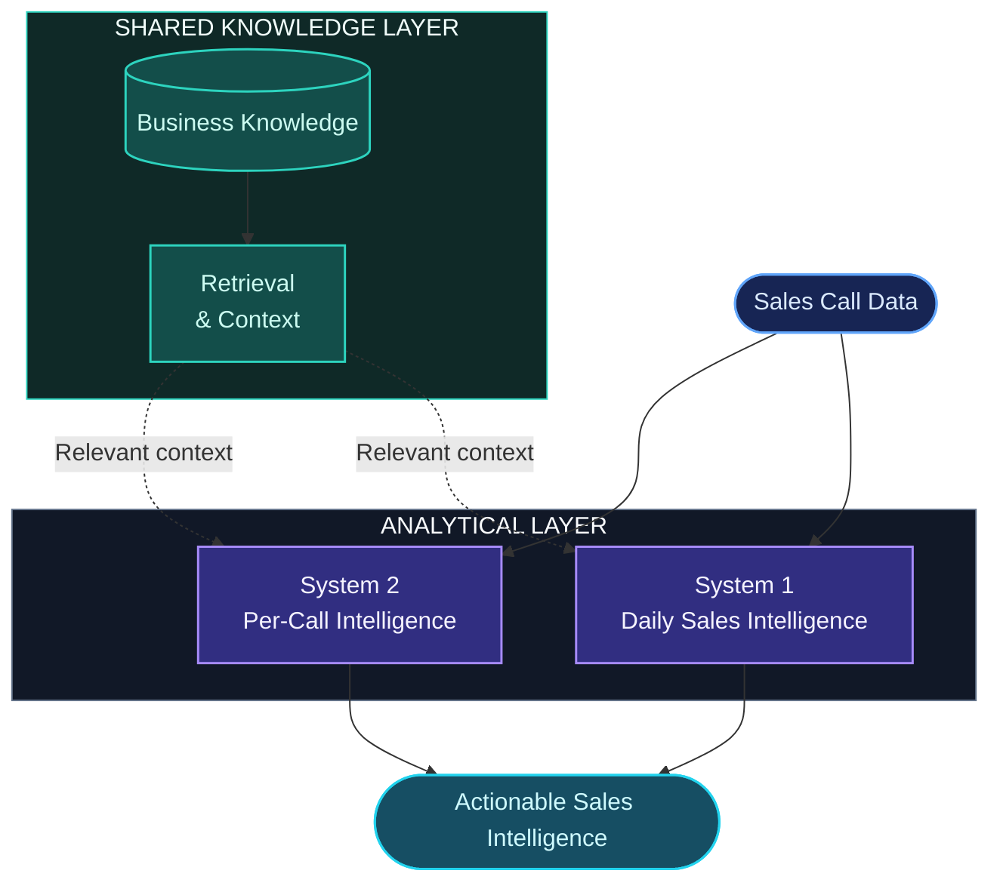
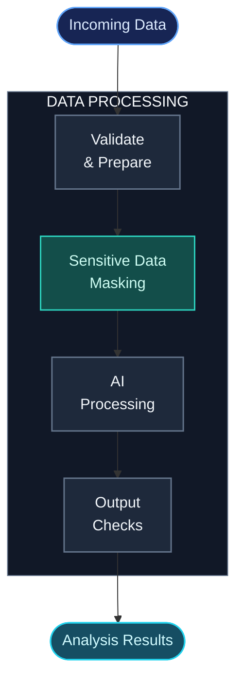
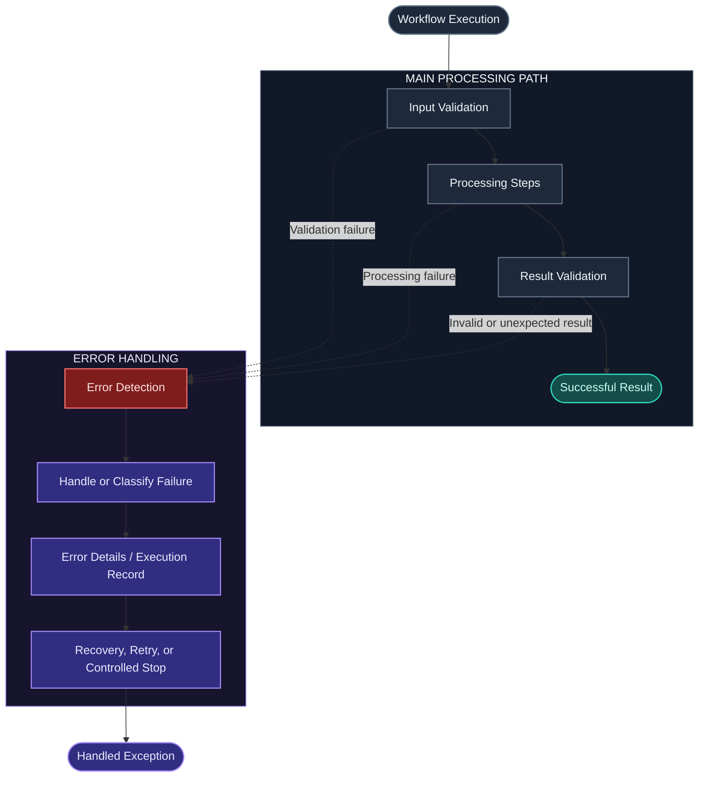

# Intelligent Sales Automation

  <strong>Turning Sales Conversations into Actionable Intelligence.</strong>
   
  AI Engineering · LLMs · RAG · Workflow Automation

  
  
  
  

---

## Overview

Sales calls contain valuable information about customer needs, objections, buying signals, and sales performance. The challenge is turning that information into useful insights without relying entirely on manual review.

**Intelligent Sales Automation** uses AI, Retrieval-Augmented Generation (RAG), and n8n workflows to turn sales conversations into structured intelligence.

The project has two complementary systems:

- **System 2 — Per-Call Intelligence:** Analyzes individual sales conversations and extracts actionable insights.
- **System 1 — Daily Sales Intelligence:** Combines call-level information to identify broader patterns, recurring objections, and potential opportunities.
- **Shared RAG Layer:** Provides relevant business context to both systems.
- **Error Handling:** Supports more reliable workflow execution by addressing processing failures and exceptions.

The goal is to move beyond call summaries and make sales conversations more useful for individual follow-ups and broader sales decisions.

## At a Glance

| Area | Capability |
|---|---|
| Call analysis | Extracts structured insights from individual conversations |
| Daily intelligence | Identifies patterns across aggregated call data |
| Shared knowledge | Adds relevant business context through RAG |
| Audio resilience | Tested with noisy, low-quality audio at a 6 kHz sample rate |
| Data privacy | Uses masking layers to help protect sensitive customer information |
| Error handling | Includes workflow-level handling of errors and exceptions |
| Automation | Coordinates processing through n8n workflows |

---

## Architecture

The diagrams below explain how the two systems work together, how each analytical path is organized, and how privacy and error handling fit into the overall design.

They are intentionally high-level: the aim is to explain the engineering approach without exposing proprietary workflow logic, credentials, or internal configuration.

### 01. System Architecture

Both systems use the same knowledge foundation but serve different purposes. System 2 focuses on individual calls, while System 1 looks for patterns across sales activity.

### 02. System 2 — Per-Call Intelligence

System 2 takes an individual call through preparation and contextual analysis, then produces structured insights that can support follow-up and sales decisions.

**Purpose:** Turn a single sales conversation into useful, context-aware intelligence.

### 03. System 1 — Daily Sales Intelligence

System 1 looks at the bigger picture. It combines call-level results to highlight recurring objections, performance patterns, and potential opportunities.

Quantitative aggregation and AI interpretation have distinct roles: source data provides the numerical foundation, while AI helps interpret patterns and communicate the findings.

**Purpose:** Turn individual call results into a broader view of sales activity.

### 04. Privacy & Data Handling

Sales conversations may contain personal or commercially sensitive information. The project includes masking layers intended to reduce unnecessary exposure of sensitive customer details.

Masking is one part of privacy-aware processing; it does not replace access controls, secure credential management, or appropriate data-retention policies.

### 05. Error Handling & Workflow Reliability

AI workflows can encounter issues such as invalid inputs, failed processing steps, service errors, or unexpected outputs. Error handling helps make these failures easier to manage and reduces the risk of treating an unsuccessful execution as a successful result.

The diagram below presents the error-handling approach at a conceptual level. It does not expose internal recovery rules or imply that every failure can be automatically recovered.

**Why it matters:** Error handling is part of building dependable automation, not just a response to something going wrong. The exact recovery behavior depends on the type of failure and the workflow path.

---

## Workflow Architecture

The screenshots below show the n8n workflows behind the two systems. They complement the conceptual diagrams with a view of the actual workflow layouts.

### System 1 — Daily Sales Intelligence

*Workflow for daily sales intelligence and aggregated analysis.*

### System 2 — Per-Call Intelligence

*Workflow for processing and analyzing individual sales calls.*

---

## Demo — Real Sales Call Analysis

This example pairs an outbound sales call recording with its corresponding AI-generated analysis report.

**Scenario:** Scenario 5 — Outbound Call — Good Salesperson  
**Call date:** October 7, 2026

| Resource | Description |
|---|---|
| [Read the Analysis Report (PDF)](https://github.com/SinaKakavand/Intelligent_Sales_Automation/blob/main/Demo/Call%20Intelligence%20-%20Scenario%205%20-%20Outbound%20Call%20-%20Good%20Salesperson%20-%202026-10-07.pdf) | Review the generated call intelligence report |
| [Listen to the Sample Call (WAV)](https://github.com/SinaKakavand/Intelligent_Sales_Automation/blob/main/Demo/Scenario%205%20-%20Outbound%20Call%20-%20Good%20Salesperson.wav) | Listen to the audio used in the demonstration |

The demo shows how a sales conversation can become structured information for review and follow-up. It represents one scenario, not a comprehensive performance benchmark.

---

## Engineering Highlights

### Low-Quality Audio

Real-world recordings can contain noise and have limited bandwidth. During testing, the workflow successfully processed noisy, low-quality audio files with a **6 kHz sample rate**.

This is evidence from the scenarios tested, not a guarantee of identical performance across all recordings, languages, or transcription models.

### Privacy-Aware Processing

Masking layers help reduce unnecessary exposure of sensitive customer information during processing. Masking should be considered alongside access controls, credential security, data retention, and safe handling of model inputs and outputs.

### Shared RAG

Both systems use a shared retrieval layer to bring relevant business knowledge into the analysis. This gives individual-call analysis and daily intelligence a common contextual foundation.

### Structured Data and AI Interpretation

The daily intelligence path separates numerical aggregation from AI-based interpretation. Where possible, metrics should be calculated from validated source data, while AI focuses on explaining patterns and generating higher-level insights.

### Error Handling

The workflows include error-handling considerations for dealing with execution failures and exceptions. The aim is to make failures visible and manageable rather than silently treating every run as successful.

### Workflow-Oriented Engineering

n8n coordinates the automation, connecting processing steps and analytical components. The public repository documents the architecture and selected engineering decisions while keeping proprietary workflow logic private.

---

## Repository Contents

The repository includes the README and supporting materials:

- `Demo/` — sample call recordings and analysis reports.
- `Screenshots_workflow/` — screenshots of the n8n workflows.
- `Docs/` — project documentation, including the [Project Proposal (PDF)](Docs/Proposal%20for%20Intelligent_Sales_Automation.pdf).

All conceptual architecture diagrams are embedded directly in this README using Mermaid. No separate diagram files are required.

---

## Scope & Transparency

This repository is an **AI Engineering Case Study**, not a public release of the complete production workflow.

It shares the project's architecture, analytical approach, selected workflow screenshots, and demonstration materials while keeping proprietary implementation details private.

The diagrams describe the design at a high level. In particular, the error-handling diagram illustrates a conceptual control flow rather than guaranteeing specific retry, recovery, or logging behavior for every failure.

Audio-resilience statements refer to the scenarios tested and should not be interpreted as universal performance guarantees.

---

## Future Directions

Potential areas for further development include:

- Evaluating transcription and analysis quality across a wider range of audio conditions.
- Adding regression tests for prompts and structured outputs.
- Measuring retrieval quality and contextual grounding.
- Tracking latency, processing cost, and failure rates.
- Further evaluating privacy controls and data-handling boundaries.
- Incorporating human review for uncertain or high-impact findings.

---

## Technology Focus

`n8n` · `LLMs` · `Retrieval-Augmented Generation` · `AI Engineering` · `Sales Analytics` · `Workflow Automation` · `Data Privacy` · `Error Handling` · `Reliability`

---

  <strong>Intelligent Sales Automation</strong>
   
  Turning Sales Conversations into Actionable Intelligence.

