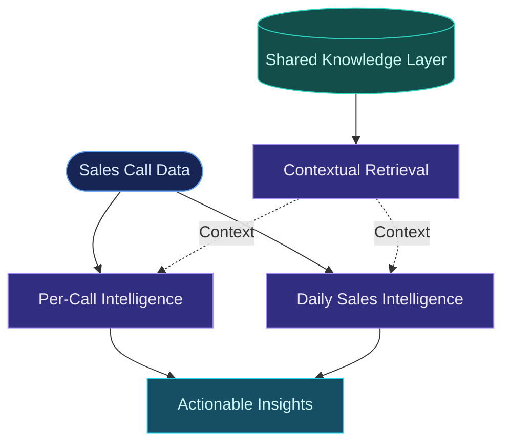
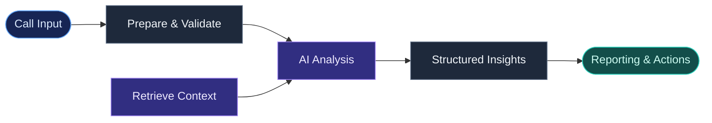
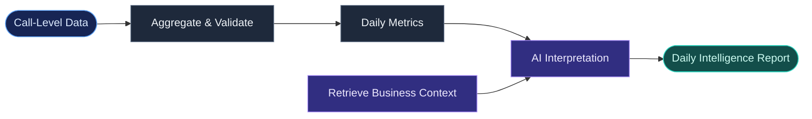
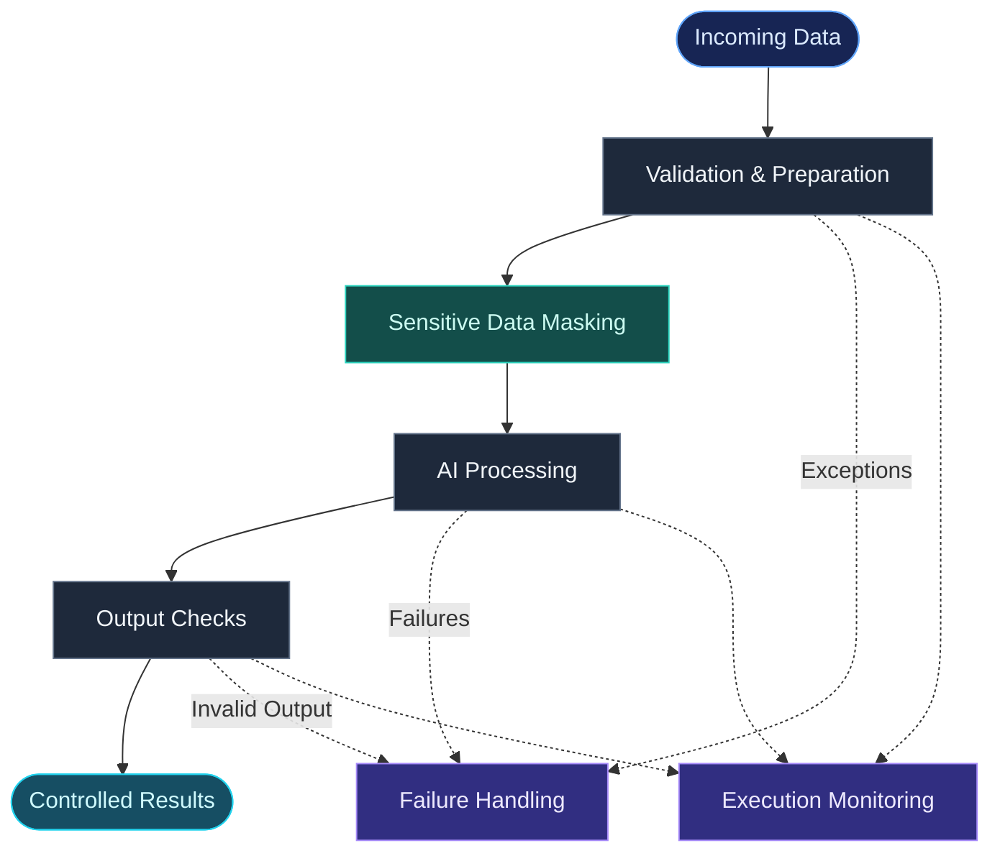

# Intelligent Sales Automation

  <strong>Turning sales conversations into actionable intelligence.</strong>
   
  AI Engineering · LLMs · RAG · Workflow Automation

  
  
  
  

---

## Overview

Sales calls are more than conversations. They contain signals about customer needs, objections, buying intent, sales performance, and opportunities for improvement.

**Intelligent Sales Automation** turns those conversations into structured, context-aware sales intelligence through automated workflows and LLM-based analysis.

The system is designed around two complementary analytical paths, supported by a shared Retrieval-Augmented Generation (RAG) layer:

- **Per-Call Intelligence:** Understands individual conversations and extracts actionable insights.
- **Daily Sales Intelligence:** Analyzes call-level information collectively to identify patterns, trends, and opportunities.
- **Shared Knowledge Layer:** Provides relevant business context to both analytical paths.

The goal is not simply to summarize calls. It is to make sales conversations more useful for decision-making.

> **Engineering focus:** Context-aware reasoning, noisy-audio resilience, privacy-aware processing, and workflow reliability.

## At a Glance

| Area | What it does |
|---|---|
| Conversation analysis | Extracts structured insights from individual calls |
| Sales intelligence | Identifies patterns across daily call data |
| Knowledge grounding | Uses shared RAG to provide relevant business context |
| Audio resilience | Successfully tested with noisy, low-quality audio at a 6 kHz sample rate |
| Data privacy | Applies masking layers to sensitive customer information |
| Automation | Coordinates processing through workflow orchestration |

---

## Architecture

The architecture is intentionally presented at a high level. These diagrams explain the system's engineering concepts without exposing proprietary workflow logic, internal configuration, or sensitive integration details.

### 01. System Overview

Both analytical systems use the same knowledge layer, but serve different decision-making needs.

### 02. Per-Call Intelligence — System 2

Each call is processed independently to produce structured information that can support follow-up and sales decisions.

**Primary purpose:** Turn a single conversation into useful, context-aware sales intelligence.

### 03. Daily Sales Intelligence — System 1

Individual call results become a broader view of sales activity. Quantitative aggregation provides the foundation; AI helps interpret the resulting patterns.

**Primary purpose:** Identify recurring objections, performance patterns, risks, and opportunities across multiple calls.

### 04. Trust, Privacy & Reliability

Audio quality, sensitive customer information, and workflow failures are practical engineering concerns—not afterthoughts.

*The diagrams communicate the system's design at a conceptual level. They are not intended to expose implementation-specific workflow nodes or imply that every illustrated control is deployed in every processing path.*

---

## Workflow Architecture

The diagrams below show the actual n8n workflows behind the two intelligence systems. They complement the high-level architecture diagrams with a visual reference to the workflow implementation.

### System 1 — Daily Sales Intelligence

*The workflow responsible for daily sales intelligence and aggregated analysis.*

### System 2 — Per-Call Intelligence

*The workflow responsible for processing and analyzing individual sales calls.*

---

## Demo — Real Sales Call Analysis

This demonstration presents an outbound sales call featuring a good salesperson, along with the corresponding AI-generated call intelligence report.

It provides a practical view of how the system transforms a sales conversation into structured analytical output.

**Scenario:** Scenario 5 — Outbound Call — Good Salesperson  
**Call date:** October 7, 2026

| Resource | Description |
|---|---|
| [Read the Analysis Report (PDF)](https://github.com/SinaKakavand/Intelligent_Sales_Automation/blob/main/Demo/Call%20Intelligence%20-%20Scenario%205%20-%20Outbound%20Call%20-%20Good%20Salesperson%20-%202026-10-07.pdf) | Review the generated call intelligence report |
| [Listen to the Sample Call (WAV)](https://github.com/SinaKakavand/Intelligent_Sales_Automation/blob/main/Demo/Scenario%205%20-%20Outbound%20Call%20-%20Good%20Salesperson.wav) | Access the audio recording used in the demonstration |

### What This Demo Illustrates

- An example of an outbound sales conversation.
- The relationship between a call recording and its corresponding analysis report.
- How conversational data can be transformed into structured sales intelligence.

*The demonstration illustrates one scenario and should not be interpreted as a comprehensive performance benchmark.*

---

## Engineering Highlights

### 1. Resilience to Low-Quality Audio

Real-world sales recordings are not always clean. Calls may contain background noise, limited bandwidth, weak microphones, or other recording artifacts.

During testing, the workflow successfully processed audio files with a **6 kHz sample rate**, including low-quality recordings with substantial noise.

This is a meaningful practical test because the system was evaluated beyond ideal recording conditions.

The result describes the tested scenarios; it is not a guarantee of equivalent performance for every recording, language, noise level, or transcription model.

### 2. Privacy-Aware Customer Data Handling

Sales conversations can contain personally identifiable and commercially sensitive information.

The system includes **masking layers for sensitive customer information** to reduce unnecessary exposure during processing.

The intended privacy approach is to:

- Identify sensitive information that should be protected.
- Mask relevant customer details at appropriate processing stages.
- Avoid exposing real customer information in public documentation and demonstrations.
- Keep credentials, private integration details, and production payloads out of the repository.

Masking is one layer of privacy protection, not a substitute for access controls, secure credential management, retention policies, or appropriate handling of model inputs and outputs.

### 3. Shared RAG for Contextual Analysis

Both intelligence systems use a shared retrieval layer to bring relevant business knowledge into the analysis process.

This separates contextual knowledge retrieval from the analytical objectives of each system. Individual calls and daily aggregates can therefore be interpreted against a consistent knowledge foundation.

### 4. Structured Analytics and AI Reasoning

The daily intelligence path distinguishes quantitative aggregation from AI-based interpretation.

Where possible, metrics should be computed from validated source data, while the language model focuses on explaining patterns and generating higher-level insights. This separation helps reduce reliance on unconstrained model-generated numbers.

### 5. Workflow-Oriented Engineering

The system is organized around automated workflow execution, with attention to input preparation, contextual retrieval, structured outputs, exception handling, and downstream reporting.

The public repository documents the architecture and engineering decisions without publishing the complete proprietary workflow.

---

## Repository Contents

The repository currently includes the README and the following supporting directories:

- [`Demo/`](./Demo) — demonstration materials.
- [`Screenshots_workflow/`](./Screenshots_workflow) — workflow screenshots.

The architecture diagrams above are embedded directly in this README using Mermaid. No separate diagram files are required.

---

## Scope & Transparency

This repository is an **AI Engineering Case Study**, not a public release of the complete production workflow.

It is intended to communicate the system's design, analytical approach, and selected engineering considerations while keeping proprietary implementation details private.

Architecture diagrams may include conceptual components used to explain design principles. They should not be interpreted as proof that every possible reliability mechanism, monitoring feature, or recovery strategy is currently deployed.

Likewise, the audio resilience statement refers to the tests described above rather than a universal performance benchmark.

---

## Future Directions

Potential areas for further development include:

- Systematic evaluation of transcription and analysis quality across audio conditions.
- Regression testing for prompts and structured outputs.
- Retrieval quality evaluation and contextual grounding checks.
- Monitoring of processing latency, cost, and failure rates.
- More comprehensive evaluation of privacy controls and data-handling boundaries.
- Human review and feedback for uncertain or high-impact findings.

---

## Technology Focus

`n8n` · `LLMs` · `Retrieval-Augmented Generation` · `AI Engineering` · `Sales Analytics` · `Workflow Automation` · `Data Privacy` · `Reliability`

---

  <strong>Intelligent Sales Automation</strong>
   
  Turning Sales Conversations into Actionable Intelligence.

